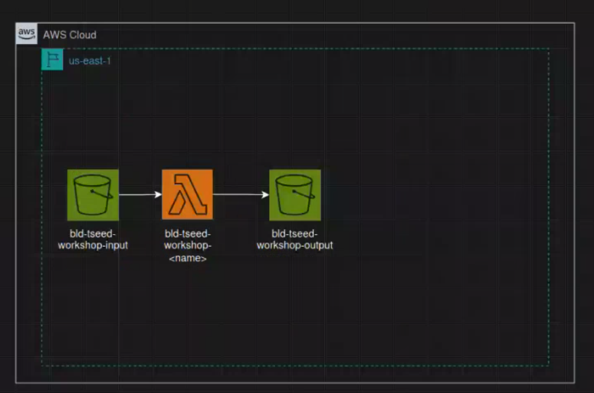
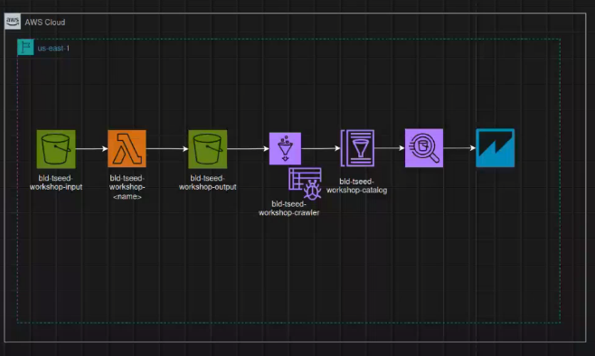

# Procesamiento y consulta de datos con servicios de AWS

Este proyecto implementa un flujo de datos en AWS para transformar un archivo CSV con
información de usuarios en archivos JSON y consultar posteriormente los datos mediante
SQL. Su propósito es practicar el uso integrado de **Amazon S3**, **AWS Lambda**,
**AWS Glue Data Catalog** y **Amazon Athena**.

## Tabla de contenido

- [Descripción de la solución](#descripción-de-la-solución)
- [Arquitectura](#arquitectura)
- [Estructura del proyecto](#estructura-del-proyecto)
- [Transformación del CSV con AWS Lambda](#transformación-del-csv-con-aws-lambda)
- [Catalogación de datos con AWS Glue](#catalogación-de-datos-con-aws-glue)
- [Consulta de datos con Amazon Athena](#consulta-de-datos-con-amazon-athena)
- [Requisitos y configuración](#requisitos-y-configuración)
- [Ejecución del flujo](#ejecución-del-flujo)
- [Consideraciones](#consideraciones)

## Descripción de la solución

El archivo de entrada es un CSV almacenado en un bucket de S3. Una función Lambda lee
el archivo, procesa cada fila y crea un archivo JSON independiente por cada registro.
Los JSON resultantes se guardan en un segundo bucket de S3.

Después de la transformación, un crawler de AWS Glue analiza los archivos JSON,
identifica su estructura y registra una tabla en Glue Data Catalog. Esta tabla permite
consultar los datos almacenados en S3 con Amazon Athena y utilizarlos posteriormente
desde una herramienta de visualización.

El flujo general es:

1. Almacenar el archivo CSV en el bucket de entrada.
2. Ejecutar la función Lambda.
3. Leer y limpiar cada registro del CSV.
4. Guardar cada registro como un archivo JSON en el bucket de salida.
5. Ejecutar el crawler de AWS Glue sobre los JSON.
6. Registrar o actualizar la tabla en Glue Data Catalog.
7. Consultar la tabla mediante Amazon Athena.

## Arquitectura

Todos los recursos representados en los diagramas se encuentran en la región
`us-east-1`.

### Etapa 1: transformación con Lambda



En esta etapa intervienen los siguientes componentes:

- **Bucket S3 de entrada:** contiene el archivo CSV original.
- **AWS Lambda:** ejecuta el código de `convert_csv_to_json.py`.
- **Bucket S3 de salida:** almacena un archivo JSON por cada fila del CSV.

### Etapa 2: catalogación y consulta



La segunda etapa amplía el flujo anterior:

- **AWS Glue Crawler:** inspecciona los JSON almacenados en el bucket de salida.
- **AWS Glue Data Catalog:** conserva los metadatos y el esquema de la tabla.
- **Amazon Athena:** ejecuta consultas SQL directamente sobre la información en S3.
- **Capa de visualización:** puede consumir los resultados obtenidos con Athena.

## Estructura del proyecto

```text
.
├── AWSGlue_architecture.png  # Diagrama completo de Glue, Athena y visualización
├── Ejercicio_lambda.png      # Diagrama de transformación S3-Lambda-S3
├── convert_csv_to_json.py    # Código de la función Lambda
├── query.sql                 # Consulta ejecutada en Amazon Athena
└── README.md                 # Documentación del proyecto
```

## Transformación del CSV con AWS Lambda

El archivo [`convert_csv_to_json.py`](./convert_csv_to_json.py) contiene el punto de
entrada de la función:

```python
def lambda_handler(event, context):
```

La función realiza las siguientes operaciones:

1. Crea un cliente de Amazon S3 mediante `boto3`.
2. Descarga el CSV configurado en `INPUT_BUCKET` e `INPUT_KEY`.
3. Decodifica el contenido como UTF-8 y admite archivos con marca BOM gracias a
   `utf-8-sig`.
4. Utiliza `csv.DictReader` para tomar la primera fila como nombres de columnas.
5. Elimina espacios al inicio y al final de nombres y valores.
6. Serializa cada fila como un objeto JSON, conservando caracteres Unicode.
7. Carga cada JSON al bucket de salida con el tipo de contenido
   `application/json`.
8. Devuelve una respuesta con la cantidad y las rutas de los archivos generados.

### Configuración utilizada

| Variable | Valor | Descripción |
|---|---|---|
| `INPUT_BUCKET` | `bld-tseed-workshop-input-semillero-2026-q4` | Bucket que contiene el CSV |
| `INPUT_KEY` | `jan-sanchez/users_dataset_100.csv` | Ruta del archivo de entrada |
| `OUTPUT_BUCKET` | `bld-tseed-workshop-output-semillero-2026-q4-d` | Bucket que recibe los JSON |
| `OUTPUT_PREFIX` | `jan-sanchez/` | Prefijo de los objetos de salida |

Los nombres de salida siguen este patrón:

```text
s3://bld-tseed-workshop-output-semillero-2026-q4-d/jan-sanchez/users_dataset_100_registro_<n>.json
```

Por ejemplo, el primer registro se almacena como
`users_dataset_100_registro_1.json`. Todos los valores se mantienen como texto durante
esta transformación; los tipos se interpretan posteriormente al catalogar o consultar
los datos.

La respuesta de una ejecución exitosa tiene una estructura similar a la siguiente:

```json
{
  "statusCode": 200,
  "body": "{\"source\": \"s3://.../users_dataset_100.csv\", \"generated\": 100, \"files\": [\"jan-sanchez/users_dataset_100_registro_1.json\"]}"
}
```

## Catalogación de datos con AWS Glue

Los JSON generados son datos semiestructurados. Para consultarlos de forma relacional,
el crawler de AWS Glue utiliza como origen el prefijo del bucket de salida:

```text
s3://bld-tseed-workshop-output-semillero-2026-q4-d/jan-sanchez/
```

Al ejecutar el crawler:

1. AWS Glue examina los archivos.
2. Infiere las columnas y sus tipos.
3. Registra la tabla `jan_sanchez` en la base de datos
   `bld-tseed-workshop-jan-sanchez`.
4. Deja los metadatos disponibles en `AwsDataCatalog` para que Athena pueda
   consultarlos.

Los archivos continúan almacenados en S3; Glue Data Catalog conserva únicamente su
estructura y ubicación.

## Consulta de datos con Amazon Athena

El archivo [`query.sql`](./query.sql) contiene la consulta utilizada:

```sql
SELECT *
FROM "AwsDataCatalog"."bld-tseed-workshop-jan-sanchez"."jan_sanchez"
WHERE try_cast(age AS integer) > 35
  AND languages LIKE '%English%';
```

La referencia de la tabla está compuesta por:

- **Catálogo:** `AwsDataCatalog`.
- **Base de datos:** `bld-tseed-workshop-jan-sanchez`.
- **Tabla:** `jan_sanchez`.

La consulta devuelve todos los usuarios que cumplen simultáneamente estas condiciones:

- Su edad es mayor a 35 años.
- El campo `languages` contiene el texto `English`.

Se usa `try_cast(age AS integer)` porque el valor de `age` puede estar catalogado como
texto. A diferencia de `CAST`, `TRY_CAST` devuelve `NULL` cuando encuentra un valor no
numérico y evita que toda la consulta falle por ese registro.

## Requisitos y configuración

Para reproducir el proyecto se requiere:

- Una cuenta de AWS con acceso a la región `us-east-1`.
- Los buckets S3 de entrada y salida.
- Una función AWS Lambda con un runtime compatible con Python 3.
- Un rol de ejecución para Lambda con permisos mínimos para:
  - `s3:GetObject` sobre el archivo o prefijo de entrada.
  - `s3:PutObject` sobre el prefijo de salida.
  - Escritura de logs en Amazon CloudWatch.
- Un crawler de AWS Glue con permiso de lectura sobre el bucket de salida y permiso
  para actualizar Glue Data Catalog.
- Acceso a Amazon Athena y una ubicación S3 configurada para guardar sus resultados.

`boto3` está disponible de forma predeterminada en el runtime administrado de AWS
Lambda, por lo que no es necesario incluirlo manualmente en un despliegue básico.

## Ejecución del flujo

1. Cargar `users_dataset_100.csv` en:

   ```text
   s3://bld-tseed-workshop-input-semillero-2026-q4/jan-sanchez/users_dataset_100.csv
   ```

2. Crear o actualizar la función Lambda con el contenido de
   `convert_csv_to_json.py`. El handler debe apuntar a:

   ```text
   convert_csv_to_json.lambda_handler
   ```

3. Ejecutar la función Lambda. El evento puede ser un objeto JSON vacío, ya que la
   versión actual toma el bucket y la clave de entrada desde constantes del código:

   ```json
   {}
   ```

4. Confirmar en los logs de CloudWatch la cantidad de archivos generados y verificar
   los JSON en el bucket de salida.
5. Ejecutar el crawler de AWS Glue y comprobar que la tabla `jan_sanchez` esté
   disponible en Data Catalog.
6. Abrir el editor de Athena, seleccionar el catálogo y la base de datos, y ejecutar
   el contenido de `query.sql`.

## Consideraciones

- La implementación actual procesa un archivo específico y no obtiene la ruta desde el
  evento de S3.
- Una nueva ejecución sobrescribe los JSON que tengan los mismos nombres.
- El CSV debe contener encabezados, porque estos se convierten en las claves de cada
  objeto JSON.
- La función carga el CSV completo en memoria. Para archivos de gran tamaño sería
  conveniente procesar el contenido por partes o utilizar un servicio como AWS Glue.
- Conviene configurar variables de entorno para buckets, claves y prefijos en lugar de
  mantener estos valores dentro del código.
- En un entorno productivo se recomienda agregar manejo de excepciones, métricas,
  validación de datos y permisos IAM de mínimo privilegio.
